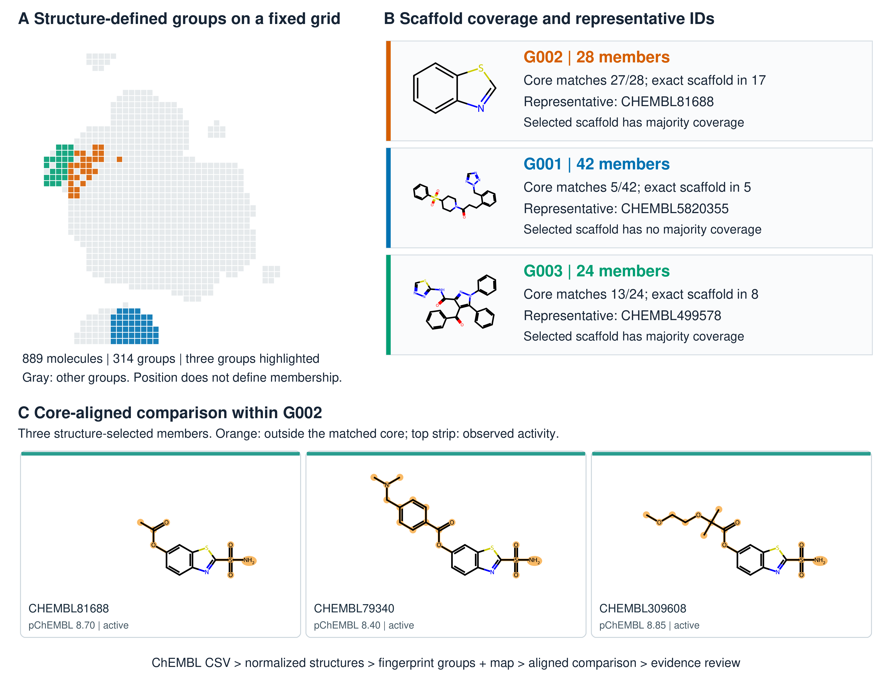

# ChemGridMap

[](https://github.com/Quinnball/ChemGridMap/actions/workflows/tests.yml)
[](LICENSE)
[](https://www.python.org/)

ChemGridMap turns molecular structures and pActivity measurements into an
auditable one-molecule-per-cell chemical map. It preserves source records,
separates structure groups from map position, and exposes activity support,
neighbor recall and group-core coverage as distinct reliability layers.
Use it from Python, the command line or a local browser interface.



## Install

Python 3.10 or newer is required; Python 3.12 is recommended. UMAP is installed
with the core package.

After the 0.5.0 PyPI release:

```bash
python -m pip install chemgridmap
```

For the current GitHub source:

```bash
python -m pip install "git+https://github.com/Quinnball/ChemGridMap.git"
```

For development:

```bash
git clone https://github.com/Quinnball/ChemGridMap.git
cd ChemGridMap
python -m venv .venv
source .venv/bin/activate
python -m pip install -e ".[dev]"
```

On Windows PowerShell, activate the environment with
`.venv\Scripts\Activate.ps1`.

The CI suite is configured for Python 3.10 and 3.12 on Linux, macOS and
Windows. CI resolves current compatible dependency versions; each run manifest
records the versions actually used. The exact dependency set used to prepare
the revision environment is pinned in
[`requirements-paper.lock.txt`](requirements-paper.lock.txt), including
numba, pynndescent, llvmlite and UMAP. The versions in `pyproject.toml` are
minimum bounds and have not been tested separately.

## Quick start

Download the activities for ChEMBL target CA II (`CHEMBL205`), include
`pChEMBL Value`, `Standard Relation`, `Standard Units`, document and
quality-flag fields, then run:

```bash
chemgridmap chembl205_ic50.csv \
  --input-format chembl \
  --target-id CHEMBL205 \
  --output-dir caii_map
```

The 0.5.0 defaults are UMAP, neighbor-refined grid placement,
coverage-target group cores, and Gaussian activity-class support. To launch the
same workflow in the local browser:

```bash
chemgridmap-app
```

The browser keeps files on the computer, lets you choose CSV columns, displays
all three reliability layers, and exports the source-record audit with the map.

The package also contains a CA II smoke test:

```bash
python -m chemgridmap.app --smoke-test --output-dir caii_smoke
```

This uses UMAP by default and verifies that CHEMBL20 resolves to its retained
source records and median pChEMBL value.

## Reading the three reliability layers

**Activity evidence.** The main activity layer keeps the observed
molecule-level median and class. In the separate class-support layer, a pale
(`uncertain`) cell means that document-balanced evidence does not reach the
configured support level. With the default `--offset-display uncertain`, it
also means that the entry occurs in a document from a flagged offset pair. A
document pair is flagged when it meets the configured minimum shared-entry,
median-difference and sign-agreement criteria (defaults: 3, 1 log unit and
80%). A pale cell is not a missing measurement, and its class is not changed.
With `--offset-display none`, touched entries remain visible with a bottom-left
marker but `class_status` depends only on support. Their model probabilities
are unchanged in either mode.

All five settings are available in `annotate_activity_confidence`,
`prepare_generic_activity_records`, the CLI and the browser:
`--support-level`, `--offset-display`, `--offset-min-shared`,
`--offset-min-difference` and `--offset-sign-agreement`. Fits and run manifests
record the settings. Inspect a cell to compare document counts, evidence units,
σ_doc and its degrees of freedom, class probabilities, all touching offset
pairs and the number of entries each pair touches.

**Neighbor recall.** The neighbor-recall layer reports how many
fingerprint-space neighbors also appear among the selected cell's tie-aware
grid neighbors. The default `neighbor_recall` retains every distance tie, so a
neighbor set can contain more than k members. `neighbor_recall_fixed_k`
reports the expected recall after independently breaking each row's ties at
random, with total weight k. A dark cell has better local neighborhood
agreement; a pale cell is a warning that the 2D layout does not preserve that
local fingerprint neighborhood. Grid adjacency by itself is not evidence of
chemical or biological similarity. `neighbor_kth_similarity` gives the kth
Morgan neighbor's Tanimoto similarity; descriptor/embedding maps instead write
`neighbor_kth_distance`.

Exported reliability layers use opaque cell colors. Full-detail structure cells
have a colored frame occupying 8% of each side, a white inset, and the structure
inside that inset. At overview scale the white inset, structure and frame
decoration hide together, leaving the full cell color visible. The five
neighbor-recall colors and corner markers are identical in SVG, PNG/PDF and the
browser.

**Core coverage.** For each representation-defined structure group, the default
core is the largest member scaffold or scaffold-network ring fragment that
matches at least 80% of members. The comparison reports the actual coverage
count and fraction. `coverage`, `most_frequent` and optional `fmcs` cores are
selectable; an FMCS timeout is recorded because a partial search can depend on
machine speed and load. `core_smiles_attached` is a valid SMILES drawing of the
core with `[*]` at bonds cut from its matched parent molecule; the browser uses
it when drawing the selected core. `core_smiles_attached_source` is
`matched_member`, `matched_member_kekule`, or empty when no attached core could
be built. FMCS cores contain no stereochemical information; their containment
checks use the same chirality-aware matching rule as the other core methods.

`is_conflicted` remains in exported tables for compatibility. Its alias
`wide_record_range` has the same value and names the rule directly: records
span more than one log unit or lie on both sides of the class thresholds.

To reproduce the earlier 0.4 layout and core policy explicitly:

```bash
chemgridmap chembl205_ic50.csv --input-format chembl \
  --projection pca --grid-refinement none --core-rule most_frequent \
  --no-activity-confidence --output-dir legacy_0_4
```

## Generic activity records

Non-ChEMBL CSVs can be used directly when they contain a compound ID, SMILES,
pActivity value (`-log10 M`) and source-document ID:

```csv
compound_id,smiles,p_activity,document_id,relation
CMP-001,CCO,6.3,DOC-A,=
CMP-001,OCC,5.9,DOC-B,=
CMP-002,c1ccccc1,7.2,DOC-A,=
```

```bash
chemgridmap records.csv \
  --compound-column compound_id \
  --smiles-column smiles \
  --value-column p_activity \
  --document-column document_id \
  --relation-column relation \
  --output-dir generic_map
```

Rows are grouped by compound ID and the displayed pActivity is the median.
With a document column, class support is calculated by default with the same
evidence-unit and variance code used for ChEMBL input. `--evidence-model
gaussian` is the default; `exclude-flagged` is the explicit alternative that
removes evidence units containing documents in systematic offset pairs and
falls back to Gaussian support where no unit remains. Use
`--no-merge-identical-documents` to keep re-reported identical values as
separate evidence units. The support and offset criteria described above apply
to generic records as well.

A curated one-row-per-molecule table remains supported through `--smiles-col`,
`--value-col` and `--label-col`.

## Python API

The public functions for evidence units, σ_doc, class probabilities, offset
pairs, both neighbour-recall definitions, structure groups and cores are listed
in `chemgridmap.__all__`. This example is kept executable in
[`examples/python_api.py`](examples/python_api.py).

```python
from pathlib import Path

import pandas as pd

from chemgridmap import (
    annotate_activity_confidence,
    build_grid_map,
    curate_chembl_activity_data,
)


def run(input_path, output_dir, *, target_id="CHEMBL205",
        activity_type="IC50", projection="umap"):
    raw = pd.read_csv(input_path, encoding="utf-8-sig")
    curated = curate_chembl_activity_data(
        raw, target_id=target_id, activity_type=activity_type
    )
    document_column = curated.report["detected_columns"]["document_id"]
    molecules = curated.molecules
    if document_column:
        molecules, fit = annotate_activity_confidence(
            molecules,
            curated.retained_records,
            value="activity_pchembl_raw",
            document=document_column,
        )
        curated.report["activity_confidence"] = fit
    result = build_grid_map(
        molecules,
        output_dir=output_dir,
        name="caii",
        smiles_col="canonical_smiles",
        value_col="activity_pchembl",
        label_col="activity_class",
        projection=projection,
        map_color_modes=(
            ["class_support", "neighbor_recall"]
            if "class_status" in molecules else ["neighbor_recall"]
        ),
    )
    columns = [
        "molecule_identity_key", "activity_pchembl", "class_confidence",
        "class_status", "status_reason", "offset_pair_touched",
        "neighbor_recall", "neighbor_recall_fixed_k",
        "neighbor_kth_similarity", "structure_group",
    ]
    result.data[columns].to_csv(
        Path(output_dir) / "entry_reliability.csv", index=False
    )
    core_columns = [
        "structure_group", "size", "core_smiles", "core_smiles_attached",
        "core_coverage_count", "core_coverage_fraction",
    ]
    pd.DataFrame(result.structure_groups)[core_columns].to_csv(
        Path(output_dir) / "group_cores.csv", index=False
    )
    return result


if __name__ == "__main__":
    run("chembl205_ic50.csv", "caii_map")
```

## Outputs

A run writes:

- `<name>_grid_coordinates.csv`: molecule annotations, evidence support,
  projection coordinates and grid cells;
- `<name>_metrics.csv`: projection/grid fidelity and neighbor metrics;
- `<name>.svg`, `.png` and `.pdf`: the main activity-colored map;
- optional `<name>_class_support`, `_neighbor_recall` and
  `_structure_group` layers;
- structure-group summaries and a trimmed member table containing identifiers,
  grid positions and group/scaffold/core fields;
- an inspector-compatible source-record table for ChEMBL input;
- `<name>_run_manifest.json`: parameters, software versions, diagnostics and
  SHA-256 digests;
- `<name>_results.zip`: the files from one run.

For additional map layers:

```bash
chemgridmap chembl205_ic50.csv --input-format chembl \
  --map-color-modes activity class_support neighbor_recall structure_group \
  --output-dir caii_layers
```

Main exported columns:

- `grid_coordinates.csv`: `molecule_identity_key`, `canonical_smiles`,
  `activity_pchembl`, `activity_class`, `n_records`, `pchembl_min`,
  `pchembl_max`, `is_conflicted`, `wide_record_range`, `class_confidence`,
  `class_reproducibility`, `class_status`, `status_reason`,
  `offset_pair_touched`, `n_documents`, `n_evidence_units`, `neighbor_recall`,
  `neighbor_recall_fixed_k`, `neighbor_kth_similarity`,
  `neighbor_shared_count`, `grid_neighbor_count`,
  `projection_x`, `projection_y`, `grid_row`, `grid_col`, `structure_group`.
- `metrics.csv`: representation and projection names, projection/grid
  diagnostics, assignment method, tie-aware mean recall and fixed-k mean
  recall.
- `structure_groups.json`: group size and members, `core_smiles`,
  `core_smiles_attached`, core rule and coverage, scaffold counts, and FMCS
  timeout status.
- `structure_members.csv`: identifier, grid, group, scaffold and core fields;
  activity columns and the full map annotation set are not duplicated here.
- `document_offsets.csv`: evaluated document pairs, shared entries, median,
  mean and SD offsets, sign agreement, systematic-offset status and the number
  of entries touched by the union of both documents.
- `run_manifest.json`: software version and source-tree SHA-256, Git commit and
  dirty state when available, parameters, dependency versions, σ_doc fit,
  assignment/refinement diagnostics, timings and output SHA-256 digests. Git
  dirty state covers only the package directory; commit is empty when the
  software is not in a tracked repository.

Every emitted column is defined in
[`docs/OUTPUT_COLUMNS.md`](docs/OUTPUT_COLUMNS.md); public signatures and
docstring summaries are in [`docs/API.md`](docs/API.md). Regenerate them with:

```bash
python -m chemgridmap.columns \
  --write docs/OUTPUT_COLUMNS.md \
  --write-api docs/API.md
```

Exact grouping is checked against the 10,000-entry limit before projection or
assignment. Larger maps must use `--grouping none` in the CLI or **No grouping**
in the browser. For ChEMBL parent identities that map to multiple normalized
structures, `--identity-conflicts exclude` removes all associated records,
writes `identity_conflicts.csv`, and records the count and warning in the
curation report.

## Paper reproduction

The commands for the main application analyses, E1-A/E1-B reliability analyses,
E2 multi-target evidence evaluation and E2c layout evaluation are in
[`paper/README.md`](paper/README.md). The analysis sources are included under
[`paper/strengthening/`](paper/strengthening/), with target selection rules in
[`paper/strengthening/SELECTION_RULES.md`](paper/strengthening/SELECTION_RULES.md).

To reproduce the manuscript Figure 2 reliability layers with the software's
own overview renderer:

```bash
chemgridmap chembl205_ic50.csv --input-format chembl \
  --target-id CHEMBL205 \
  --render-detail overview \
  --map-color-modes activity class_support neighbor_recall \
  --output-dir caii_fig2
```

## Citation

After the accompanying paper is published, use the preferred citation recorded
in [`CITATION.cff`](CITATION.cff). Until then, cite the ChemGridMap software
version used for the analysis:

> Qiu, Zhenming. ChemGridMap 0.5.0.

## License

ChemGridMap source code is released under the BSD 3-Clause License; see
[`LICENSE`](LICENSE). ChEMBL-derived data are distributed under the ChEMBL
data license, CC BY-SA 3.0. Check the source snapshot and attribution before
redistributing derived tables or maps.
